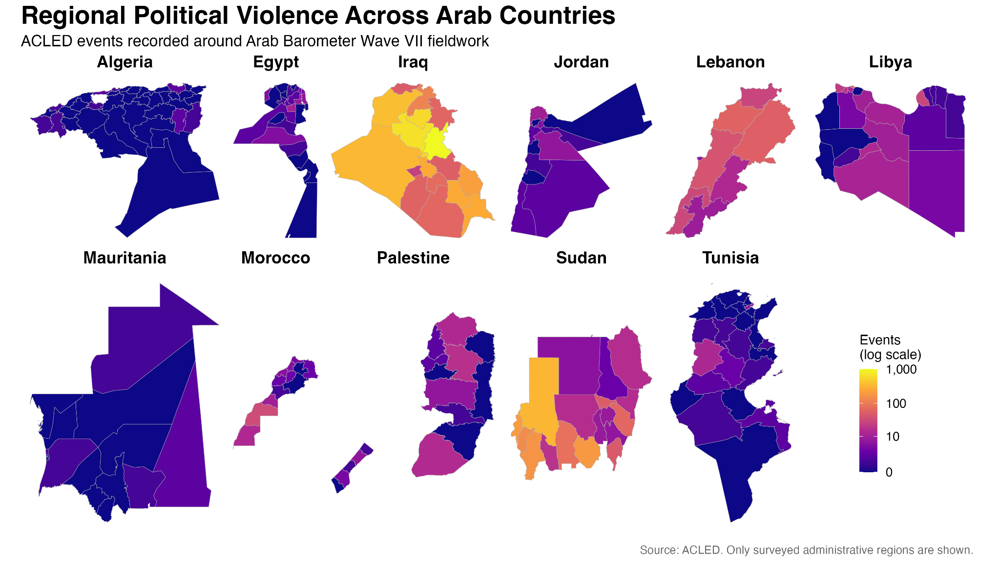
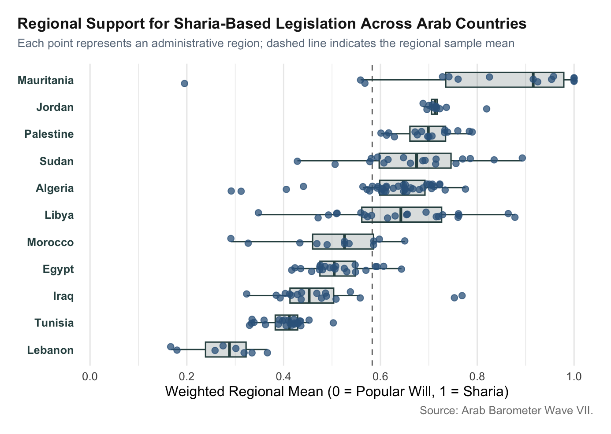
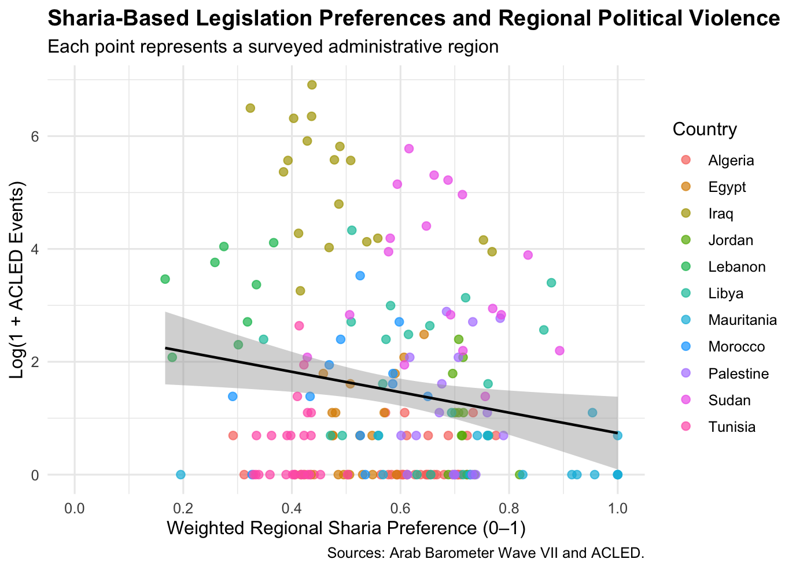
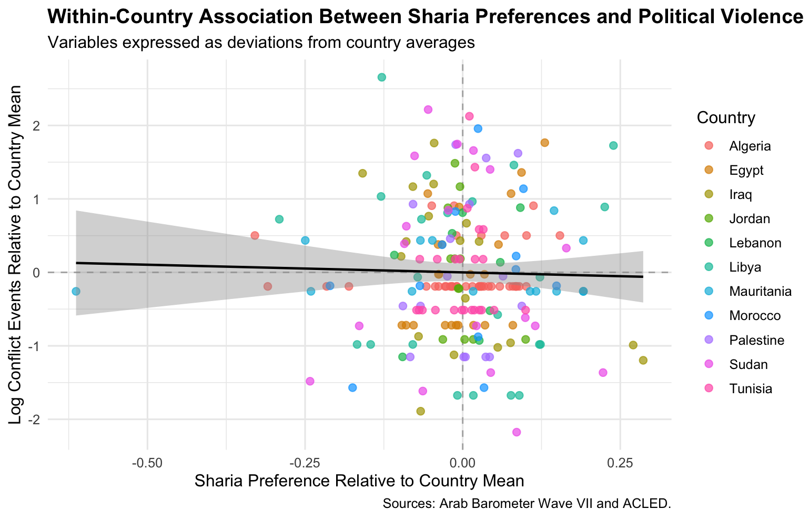

# Political Violence and Preferences for Sharia-Based Legislation

*A subnational comparison across 11 Arab countries*

**[Political Violence and Preferences for Sharia-Based Legislation](report/Report.pdf)**

## Abstract

This report examines whether regional views supportive of Sharia-based legislation are associated with higher levels of political violence across 11 Arab countries. Combining survey data from Arab Barometer Wave VII with conflict data from ACLED, 23,271 survey responses are aggregated into 206 regional scores and spatially matched to 7,115 political violence events. The ordinary least squares regression with no controls suggests a statistically inconclusive negative association between Sharia preferences and recorded conflict. This association attenuates to zero once country fixed effects are introduced.

## Conflict Data and Spatial Matching

Data on political violence comes from ACLED, which tracks geolocated conflict incidents involving both state and non-state actors (Armed Conflict Location & Event Data (ACLED), n.d.). To focus on direct political violence, this analysis leaves out riots, protests, and any clashes between two or more state actors (tagged as foreign military engagement). Events categorized as battles, explosions/remote violence, and violence against civilians are retained. Additionally, events identifiably related to the Israel-Palestinian conflict and events in Sudan’s Abyei area were also excluded. The time period of included events for each country spans 12 months before the first survey interview to 12 months after the last interview, including the fieldwork period itself.

Administrative boundaries are sourced from geoBoundaries and supplementary humanitarian files (Runfola et al., 2020). These were matched to the administrative regions coded by the surveyors using point-in-polygon spatial joins. 7,115 out of 7,563 eligible conflict events were matched and the remaining 448 unmatched events were excluded. Unsurveyed geography or coordinate inconsistencies explain unmatched events, not necessarily absence of violence.

78 regions recorded zero events, while Iraq and Sudan accounted for 89.4% of incidents. The map in Figure 2 highlights the concentration of recorded events.



*Figure 2: Recorded ACLED political-violence events across surveyed administrative regions; a common logarithmic colour scale is used, while map-panel geographic scales vary.*

For spatial matching code and geographic validation checks, see [GIS Methods](docs/GIS_METHODS.md).

## Survey Data

The dataset including interview answers and questions was taken from the Arab Barometer Wave VII survey conducted across 12 Arab countries in 2021 and 2022 (Arab Barometer, 2022). Because the chosen questions were not universally asked in all participating countries, the analysis retains Algeria, Egypt, Iraq, Jordan, Lebanon, Libya, Mauritania, Morocco, Palestine, Sudan, and Tunisia, resulting in 23,271 respondents from 206 administrative regions (table 1). Q605 was not administered in Kuwait.

To clean and prepare the survey data, nonresponses were excluded, and individual response scales reversed (higher values correspond to more support for religious legislation) and normalized using $s_{ij}=(5-Q605_{ij})/4$. Then survey-weighted mean scores were then calculated for each administrative region.



*Figure 1: Survey-weighted Sharia-legislation preferences by country; each point represents an administrative region.*

## Regression Design

Let $E_{ic}$ represent the number of matched conflict events in region $i$ of country $c$. The amount of events within regions are heavily skewed and include many zeros, hence the outcome variable is log-transformed: $Y_{ic}=\log(1+E_{ic})$.

Each region is given equal weight within both models. To account for potential correlation among regions within the same country as well as the small number of country clusters, standard errors are clustered by country using CR2 with Satterthwaite corrections. Fixed effects are used to compare regions within the same country, which accounts for national differences in conflict environments and public opinion.

## Regression Results

| | Pooled OLS | Country FE | FE: n ≥ 30 respondents | FE: excluding Iraq and Sudan |
| --- | ---: | ---: | ---: | ---: |
| Sharia preference coefficient | −1.810 | −0.208 | −0.236 | 0.511 |
| Clustered SE (CR2) | (2.069) | (0.599) | (0.715) | (0.497) |
| CR2 p-value | 0.414 | 0.743 | 0.756 | 0.377 |
| Satterthwaite d.f. | 6.31 | 4.66 | 4.79 | 3.13 |
| Regions | 206 | 206 | 187 | 170 |
| R² | 0.029 | 0.748 | 0.745 | 0.464 |

The Pooled OLS suggests a negative relationship (β̂ = −1.810), but its p-value is 0.414 and R² is only 0.029 (Table 3).



*Figure 3: Regional Sharia-legislation preferences and log event counts; fitted line shows the pooled OLS relationship.*

After introducing country controls, the coefficient falls to −0.208 (p = 0.743). The model does have a higher R² (0.748), but this reflects country intercepts, not explanatory power of Sharia preferences.



*Figure 4: Within-country deviations from country means in regional Sharia preferences and log event counts; the fitted slope equals the FE coefficient.*

## Limitations and Conclusion

Since this analysis relied on subnational averages, findings could not give interpretation on the interaction between individuals’ preference for religious legislation and their participation in political violence. Furthermore, combining conflict events from before and after the survey interviews means the study captures cross-sectional correlations. Raw event counts are affected by regional population, geographic size, and ACLED reporting coverage. Unmatched events, unequal fieldwork duration, uncertain regional attitude estimates, and omitted confounders may also matter. Even cluster inference is imprecise for only 11 countries.

Overall, the pooled negative association largely disappears when accounting for country differences. The findings do not establish any effect of Sharia-legislation preferences. Further context on geographic measurement and nation-specific factors are crucial to interpreting this comparison.

## Repository Setup

### Requirements

The analysis was conducted in R using the following packages: `tidyverse`, `sf`, `lubridate`, `patchwork`, and `clubSandwich`.

Install the required packages before running the analysis:

```r
install.packages(c("tidyverse", "sf", "lubridate", "patchwork", "clubSandwich"))
```

### Data Sources

The analysis uses three sources:

- **Arab Barometer Wave VII:** Survey data collected in 2021–2022. Available through [Arab Barometer](https://www.arabbarometer.org/surveys/arab-barometer-wave-vii/).
- **ACLED:** Geolocated political-violence event data. Available through [ACLED](https://acleddata.com/).
- **Administrative boundaries:** [geoBoundaries](https://www.geoboundaries.org/) and supplementary humanitarian boundary files for Libya and Mauritania.

The original survey and conflict datasets are not included in this repository. Download the relevant datasets through their respective providers and save them as `Barometer.csv` and `ConflictDat.csv` in the project directory.

### Geographic Data

Administrative boundaries are used to match ACLED event coordinates to Arab Barometer survey regions through point-in-polygon spatial joins.

Place the required GeoJSON files in a folder named `boundaries/`. The analysis uses geoBoundaries files for Algeria, Egypt, Iraq, Jordan, Lebanon, Morocco, Palestine, Sudan, and Tunisia, alongside `lby_admin2.geojson` and `mrt_admin1.geojson` for Libya and Mauritania.

The boundary filenames must match those referenced in the R script.

Further information on geographic matching and administrative boundary harmonization is available in [GIS Methods](docs/GIS_METHODS.md).

### Running the Analysis

1. Open `Midterm.Rproj` in RStudio.
2. Ensure both CSV datasets and the `boundaries/` folder are in the project directory.
3. Run `Midterm_Final_CR2.R` from the project root:

```r
source("Midterm_Final_CR2.R")
```

The script performs data cleaning, survey-weighted aggregation, geographic boundary matching, point-in-polygon spatial joins, and pooled and country fixed-effects regressions.

### Outputs

The analysis produces regional survey estimates and conflict event counts for 206 administrative regions across 11 Arab countries.

It also generates regression summaries, country-clustered standard errors, sensitivity analyses, and visualizations of regional Sharia-legislation preferences and political violence.

The conflict choropleth is exported as `ConflictMap.png`. Other plots are displayed during execution, with copies available in the repository's `figures/` directory.

## References

- Arab Barometer (2022). *Arab Barometer Wave VII: Survey Data, 2021–2022*. https://www.arabbarometer.org/surveys/arab-barometer-wave-vii/.
- Armed Conflict Location & Event Data (ACLED) (n.d.). *ACLED Conflict Event Data*. https://acleddata.com/.
- Piazza, James A. (2024). “Intolerance of Non-Muslim Political Rights and Engagement in Political Violence: A Study of Public Opinion in 11 Arab Countries”. *Behavioral Sciences of Terrorism and Political Aggression* 16.2. https://doi.org/10.1080/19434472.2022.2061570.
- Robbins, Michael (May 8, 2023). *A New Dawn for Political Islam?* Arab Barometer. https://www.arabbarometer.org/2023/05/a-new-dawn-for-political-islam/.
- Runfola, Daniel et al. (2020). “geoBoundaries: A Global Database of Political Administrative Boundaries”. *PLOS ONE* 15.4, e0231866. https://doi.org/10.1371/journal.pone.0231866.
