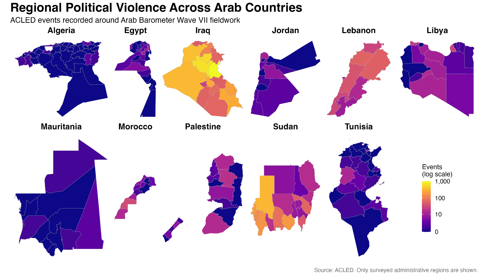

# Conflict Data and Spatial Matching

Data on political violence comes from ACLED, which tracks geolocated conflict incidents involving both state and non-state actors (Armed Conflict Location & Event Data (ACLED), n.d.). To focus on direct political violence, this analysis leaves out riots, protests, and any clashes between two or more state actors (tagged as foreign military engagement). Events categorized as battles, explosions/remote violence, and violence against civilians are retained. Additionally, events identifiably related to the Israel-Palestinian conflict and events in Sudan’s Abyei area were also excluded. The time period of included events for each country spans 12 months before the first survey interview to 12 months after the last interview, including the fieldwork period itself.

Administrative boundaries are sourced from geoBoundaries and supplementary humanitarian files (Runfola et al., 2020). These were matched to the administrative regions coded by the surveyors using point-in-polygon spatial joins. 7,115 out of 7,563 eligible conflict events were matched and the remaining 448 unmatched events were excluded. Unsurveyed geography or coordinate inconsistencies explain unmatched events, not necessarily absence of violence.

78 regions recorded zero events, while Iraq and Sudan accounted for 89.4% of incidents. The map in Figure 2 highlights the concentration of recorded events.



*Figure 2: Recorded ACLED political-violence events across surveyed administrative regions; a common logarithmic colour scale is used, while map-panel geographic scales vary.*

```r
# Combine all prepared administrative boundaries
AllBoundaries <- bind_rows(AlgeriaBoundariesMatched, EgyptBoundariesMatched, IraqBoundaries, 
                           JordanBoundaries, LebanonBoundaries, LibyaBoundaries, 
                           MauritaniaBoundaries, MoroccoBoundaries, PalestineBoundaries, 
                           SudanBoundaries, TunisiaBoundaries) %>%
  select(country, Q1) %>%
  st_transform(6933)

# Validate geographic coverage against survey regions
SurveyRegions <- SurveyDatCleaned %>%
  transmute(country = as.character(COUNTRY), Q1) %>%
  distinct()

stopifnot(
  nrow(AllBoundaries) == 206,
  nrow(SurveyRegions) == 206,
  !anyNA(AllBoundaries$Q1),
  n_distinct(AllBoundaries$Q1) == 206,
  all(st_is_valid(AllBoundaries)),
  st_crs(AllBoundaries)$epsg == 6933,
  nrow(anti_join(st_drop_geometry(AllBoundaries), SurveyRegions,
                by = c("country", "Q1"))) == 0
)

# Convert ACLED event coordinates into spatial points and assign to survey regions
ConflictPoints <- st_as_sf(ConflictDatClean1, coords = c("longitude", "latitude"), 
                           crs = 4326, remove = FALSE) %>%
  st_transform(6933)

ConflictAssigned <- ConflictPoints %>%
  st_join(AllBoundaries %>% rename(polygon_country = country), join = st_within, left = TRUE)

# Validate spatial event assignments
stopifnot(
  nrow(ConflictAssigned) == nrow(ConflictPoints),
  !anyDuplicated(ConflictAssigned$event_id_cnty),
  nrow(ConflictAssigned %>%
         st_drop_geometry() %>%
         filter(!is.na(Q1), country != polygon_country)) == 0
)

# Inspect events without a spatial match
UnmatchedEvents <- ConflictAssigned %>%
  filter(is.na(Q1))

UnmatchedEvents %>%
  st_drop_geometry() %>%
  count(country, admin1, sort = TRUE)

# Retain valid matches, aggregate conflict events, and join to all 206 surveyed regions
ConflictMatched <- ConflictAssigned %>%
  filter(!is.na(Q1))

RegionConflictCounts <- ConflictMatched %>%
  st_drop_geometry() %>%
  count(polygon_country, Q1, name = "event_count") %>%
  rename(country = polygon_country)

RegionConflictData <- AllBoundaries %>%
  left_join(RegionConflictCounts, by = c("country", "Q1")) %>%
  mutate(event_count = coalesce(event_count, 0L))

# Validate regional conflict counts
stopifnot(
  nrow(RegionConflictData) == 206,
  !anyNA(RegionConflictData$event_count),
  sum(RegionConflictData$event_count) == nrow(ConflictMatched)
)
```
